

# JARVIS · 贾维斯

### 黑色机甲，蓝色眼睛。工作台上的小小搭档。

圆润的机械猫，红色的装甲细节，还有亮起的蓝色眼睛。 
会奔跑、挥手、跳跃，也会安静地陪你等待。

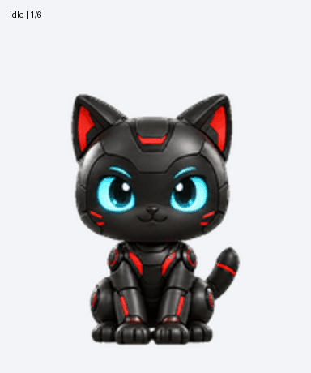

**9 种动画 · 16 个视线方向 · 73 帧 · 透明图集**

**[下载透明图集](assets/spritesheets/jarvis.png) · [查看全部动作](#九种状态陪你工作) · [查看视频](assets/previews/all-states.mp4)**

*A little mechanical companion for your workspace.*

---

## 贾维斯，准备就绪

黑灰色金属外壳、红色装甲线条、明亮的青蓝色眼睛，把机械感和小猫的亲近感放在一起。小尺寸下也能看清耳朵、表情和动作。

这套宠物已完成 Pets v2 图集校验并创建成功。本仓库提供角色透明图集与动画预览，便于查看、下载及开发自己的播放器。

## 三个瞬间，认识这只机械猫

<table>
  <tr><th>轻快移动</th><th>抬爪招呼</th><th>跳起来庆祝</th></tr>
  <tr>
    <td>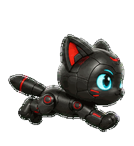</td>
    <td>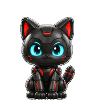</td>
    <td>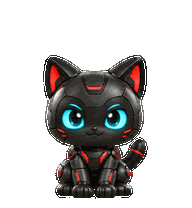</td>
  </tr>
</table>

## 九种状态，陪你工作

| 休息 · 呼吸与眨眼 | 移动 · 向右奔跑 | 移动 · 向左奔跑 |
| :---: | :---: | :---: |
| 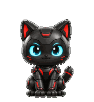 |  | 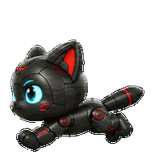 |

| 招呼 · 抬爪挥手 | 完成 · 跳跃庆祝 | 失落 · 低头垂耳 |
| :---: | :---: | :---: |
|  |  | 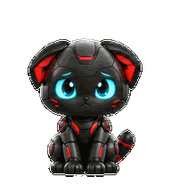 |

| 等待 · 等你回应 | 工作 · 认真思考 | 检查 · 抬头观察 |
| :---: | :---: | :---: |
| 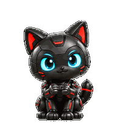 | 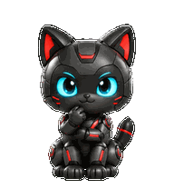 | 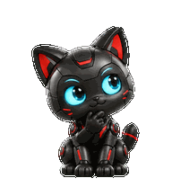 |

## 眼神，也会跟着方向走

通过抬头、低头、转头和眼神变化，组成一圈 **16 个视线方向**。方向按观看者的屏幕坐标定义，从向上开始顺时针排列。

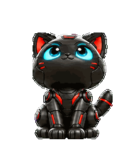

## 下载与使用

| 文件 | 用途 |
| --- | --- |
| [jarvis.png](assets/spritesheets/jarvis.png) | PNG 透明图集，保留完整 v2 布局 |
| [all-states.gif](assets/previews/all-states.gif) | 九种动作的连续演示 |
| [all-states.mp4](assets/previews/all-states.mp4) | 九种动作的视频预览 |
| [look-loop.gif](assets/previews/look-loop.gif) | 十六方向视线循环 |
| [idle-jump.gif](assets/previews/idle-jump.gif) | 休息、起跳、落地的衔接预览 |
| [pet.json](pet.json) | 图集尺寸、动作帧数与视线方向布局 |

本仓库是素材包，不是独立应用，也不包含一键安装程序。接入前请确认目标工具接受此图集布局；不能仅凭下载文件保证自动导入。

## 素材规格

| 项目 | 规格 |
| --- | --- |
| 图集 | 1536 × 2288 px，8 列 × 11 行 |
| 单帧 | 192 × 208 px |
| 常规动画 | 9 种，共 57 帧 |
| 视线方向 | 16 个，共 16 帧 |
| 总帧数 | 73 帧，另有 15 个透明空格 |
| 背景 | 透明 Alpha |

前九行依次为 `idle`、`running-right`、`running-left`、`waving`、`jumping`、`failed`、`waiting`、`running`、`review`；每行从左向右播放。最后两行是视线姿态，不是额外的常规动作。详情见 `pet.json`。

## 关于这只机械猫

使用 AI 生成角色与动作，并完成逐帧整理、透明边缘处理和图集验证。这里只发布成品素材与预览，不包含个人参考图片或制作过程记录。

**Small paws. Bright eyes. Ready to work.**

